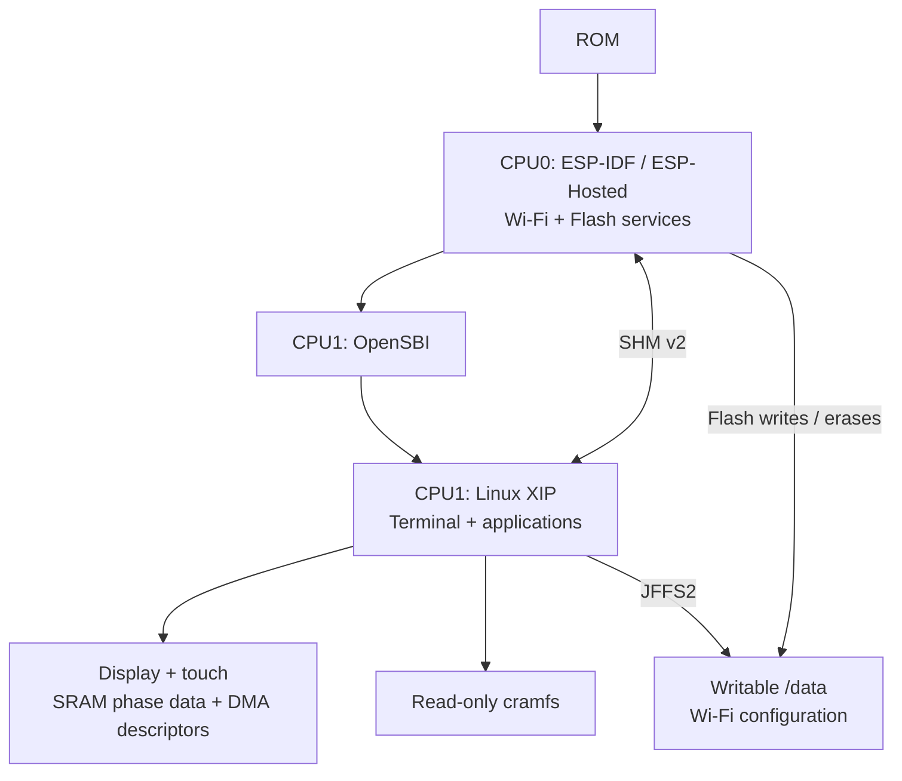

# esp32s31-ink-linux

[简体中文](README.zh-CN.md)

A native Linux project for ESP32-S31 e-paper devices. The currently supported
board is the **Metalio E-Ink4 Plus**, with an E0470A14-AF parallel e-paper panel.
The repository includes Buildroot integration, board support, drivers and a
local shell terminal with a touch keyboard.

## Features

- Built-in UTF-8 CLI symbols include arrows, rounded borders (`╭─╰─`),
  progress blocks, Braille spinners, check marks, and warning symbols.
- Portrait 684 × 1216 English terminal, running BusyBox `ash` through a PTY with
  libvterm, plus a Dropbear SSH client for outbound connections.
- Six-row QWERTY touch keyboard occupying the bottom 40%, with 60 × 73 pixel
  standard touch targets, a permanent number row and a 41 × 22 character terminal.
  Supports Shift, symbols, arrows and control keys; no press/release
  highlight refreshes. The on-screen Enter key sends Return.
- Each press of the leftmost bottom confirm button requests a full GC refresh,
  queued while busy. The other two buttons send Return; holding a button does
  not repeat.
- The Wi-Fi build supports WPA2-Personal STA, DHCP and DNS, with persistent
  network configuration and automatic connection after reboot.

## System architecture

The diagram shows the current Wi-Fi build with Linux SRAM display and touch.
SHM v2 carries network and Flash requests; display frames stay on CPU1.



## Configure Wi-Fi

Install the [Wi-Fi firmware](docs/wifi.md), then run this command without
arguments in the **board's serial shell or screen terminal**:

```sh
wifi-config
```

Enter the SSID and WPA2 password at the prompts. Password input is hidden; do not
put credentials in command arguments. Saving starts the connection using DHCP
and stores the configuration in `/data/wifi/wpa_supplicant.conf` for automatic
connection after reboot. Run `wifi-config` again to change the network.

Check authentication, the IPv4 address and the default route:

```sh
wpa_cli -i wlan0 status
ip addr show dev wlan0
ip route
```

`wpa_state=COMPLETED` confirms authentication; also confirm an IPv4 address was
assigned. See the Wi-Fi guide for [DNS, reconnection and troubleshooting](docs/wifi.md#check-and-reconnect).

## Build and flash

Use Ubuntu 24.04 x86_64 with Python 3.10 or newer. Follow the selected guide to
install dependencies and fetch the pinned sources and tools, then build from
the repository root:

| Build | Command | Guide |
| --- | --- | --- |
| Wi-Fi + Linux display/touch | `scripts/build-wifi.sh -j8` | [Wi-Fi build and installation](docs/wifi.md) |
| Linux-only (default, no wireless interface) | `scripts/build.sh -j8` | [Build and flash](docs/build.md) |

The default `scripts/build.sh` uses no ESP-IDF companion; the Wi-Fi build uses
pinned ESP-IDF/ESP-Hosted sources. Versions are recorded in
[`sources.lock.json`](sources.lock.json).

Follow the selected guide for flashing. Wi-Fi [first installation](docs/wifi.md#install-or-upgrade),
including a switch from Linux-only, initializes NVS, PHY and `/data`. Upgrades
from a matching Wi-Fi layout use the package's component upgrade script to
preserve those partitions. Keep all components from one package together.

## Status and limitations

Display, touch, keys and basic networking have been exercised on hardware.
A Wi-Fi scan/transfer stress run recorded CPU0 heap allocation failures; full
wireless-load stability, Flash garbage-collection concurrency and power-loss
recovery remain unqualified. See [validation details](docs/wifi.md#validation-and-known-limitations).

The underlying Espressif Linux stack is a developer preview. Full-temperature
operation, long-term panel life, Chinese input and general full-screen
applications are not qualified.

## Documentation

- [Build, flash, and package firmware](docs/build.md)
- [Hardware, timing, and waveform profile](docs/hardware.md)
- [Development, display API, and troubleshooting](docs/development.md)
- [Wi-Fi installation, configuration and troubleshooting](docs/wifi.md)

## License

Distributed under [GPL-2.0-only](LICENSE), retaining component-specific licenses
and exceptions. See [licenses and source attribution](LICENSES/README.md).
