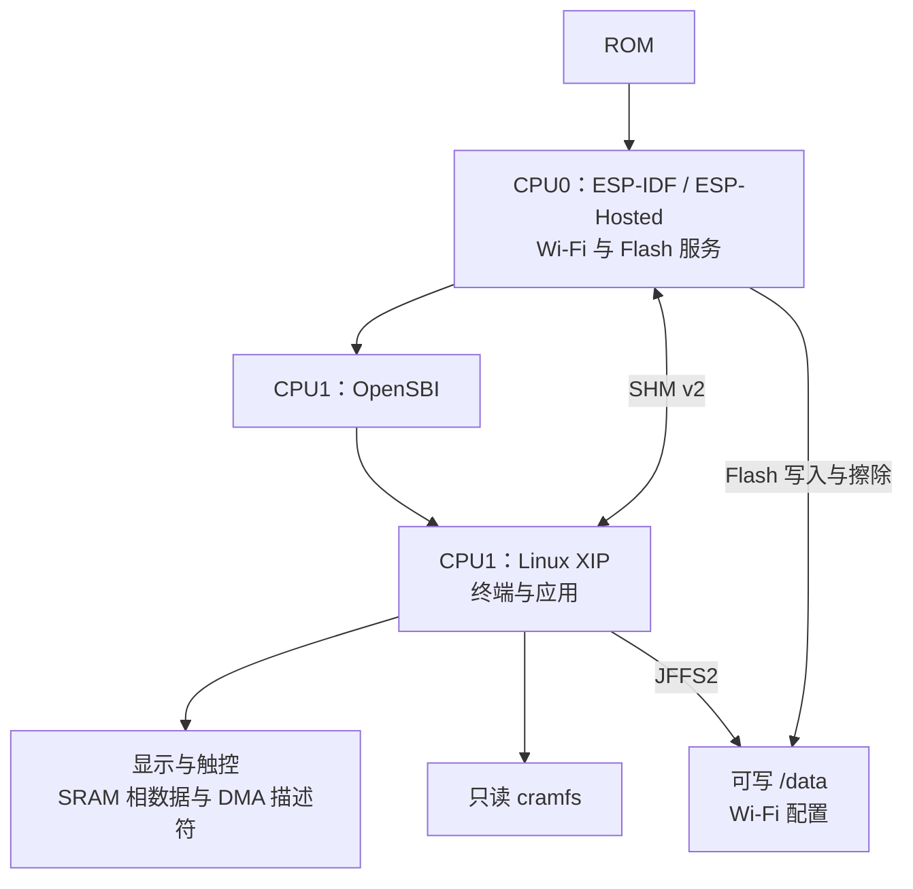

# esp32s31-ink-linux

[English](README.md)

面向 ESP32-S31 墨水屏设备的原生 Linux 工程，目前支持 **Metalio E-Ink4 Plus**，
搭载 E0470A14-AF 并行墨水屏。仓库包含 Buildroot 集成、板级支持、驱动，
以及带触摸键盘的本地 shell 终端。

## 功能

- 本地英文 shell 终端，支持通过 SSH 连接远端。
- QWERTY 触摸键盘，支持数字、符号、方向键和控制键。
- Wi-Fi 版本支持联网，网络配置持久保存，重启后自动连接。

## 系统架构

下图仅展示当前 Wi-Fi＋Linux SRAM 显示与触控模式。SHM v2 承载网络和 Flash 请求，
显示帧始终由 CPU1 处理。



## 配置 Wi-Fi

先安装 [Wi-Fi 版本固件](docs/wifi.md)，再在**设备串口 shell 或屏幕终端**中执行，不带参数：

```sh
wifi-config
```

按提示输入 SSID 和 WPA2 密码。密码输入不回显，不要将凭据放进命令参数。
保存后开始连接，通过 DHCP 获取地址；配置保存在 `/data/wifi/wpa_supplicant.conf`，
重启后自动连接。修改网络时再次运行 `wifi-config` 即可。

检查认证状态、IPv4 地址和默认路由：

```sh
wpa_cli -i wlan0 status
ip addr show dev wlan0
ip route
```

`wpa_state=COMPLETED` 表示认证完成，还应确认已取得 IPv4 地址。
DNS、重连和故障处理见 [Wi-Fi 指南](docs/wifi.md#check-and-reconnect)。

## 编译与烧录

推荐 Ubuntu 24.04 x86_64、Python ≥ 3.10。先按对应指南安装依赖、下载锁定的源码与工具，
再从项目根目录构建：

| 构建版本 | 命令 | 指南 |
| --- | --- | --- |
| Wi-Fi＋Linux 显示／触控 | `scripts/build-wifi.sh -j8` | [Wi-Fi 编译与安装](docs/wifi.md) |
| Linux-only（默认，无无线接口） | `scripts/build.sh -j8` | [编译与烧录](docs/build.md) |

默认入口 `scripts/build.sh` 不使用 ESP-IDF 协作固件；Wi-Fi 版本使用锁定的 ESP-IDF／ESP-Hosted。
版本信息见 [`sources.lock.json`](sources.lock.json)。

烧录请遵循对应指南。Wi-Fi [首次安装](docs/wifi.md#install-or-upgrade)（包括从 Linux-only 切换）
会初始化 NVS、PHY 和 `/data`；已有匹配 Wi-Fi 布局时，使用发布包的分片升级脚本保留这些分区。
所有组件须来自同一发布包。

## 状态与限制

显示、触控、三键和基本联网已做过实机验证。Wi-Fi 扫描与传输压力测试记录到 CPU0 堆分配失败，
完整无线负载稳定性、Flash 垃圾回收并发及断电恢复仍未完成验收，详见[验证记录](docs/wifi.md#validation-and-known-limitations)。

底层 Espressif Linux 仍为开发预览；全温度范围、长期屏幕寿命、中文输入和通用全屏程序不在已验证范围内。

## 文档

- [编译、烧录与打包指南](docs/build.md)
- [硬件、扫描参数与波形](docs/hardware.md)
- [开发、显示接口与故障排查](docs/development.md)
- [Wi-Fi 编译、烧录与配网](docs/wifi.md)

## 许可

项目整体按 [GPL-2.0-only](LICENSE) 分发，保留组件原有许可与例外；具体范围见
[组件许可说明](LICENSES/README.md)。
